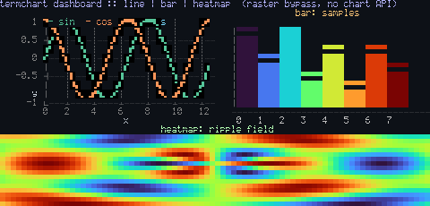
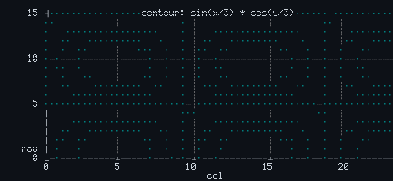
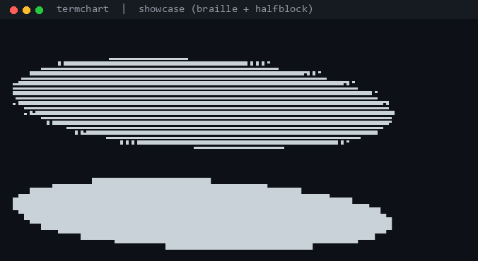
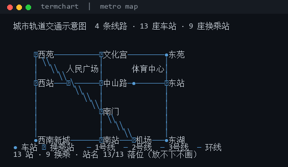
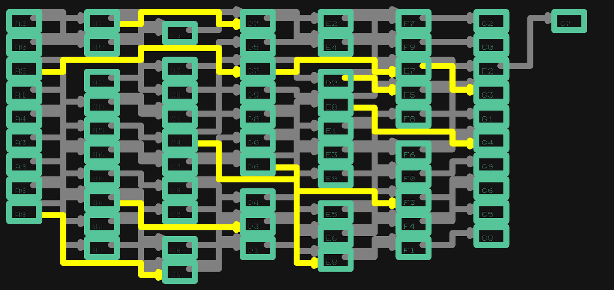

# termchart

在终端里画**真正的图**的 C++20 头文件库：折线 / 柱状 / 散点 / 迷你趋势、流程图 / 状态机 / 思维导图 /
组织架构图 / 力导向图、热力图 / 分形 / 图像预览，输出走**盲文（2×4）与半块（1×2）子像素**，
而不是拿字符凑形状。

同一份数据有三条出口：**终端实时渲染**、**矢量导出（SVG / HTML / Mermaid / JSON）**、**位图导出（PNG）**。

- **库本体零外部依赖**（测试用的 doctest 已 vendored 在 `third_party/`）；不依赖 zlib —— PNG 编解码自带。
- **按能力降级**：真彩 / 256 色 / 16 色，sixel / kitty / iTerm2 内联 / 半块字符，逐级回退且每一级都可测。
- **注册表式扩展点**：光栅器、图表类型、比例尺都可注册自定义实现。
- **护栏齐全**：分层规则、头文件自洽性、生成物一致性、每头独立编译、golden 快照、fuzz 入口、性能基线。

<p align="center">
  
  
</p>
<p align="center">
  
  
</p>
<p align="center">
  
</p>

> 上面五张都是**本仓库示例的真实产出**，没有一张是外部素材：
> 前四张是终端渲染的原始输出——`docs/gallery/` 里由 `tools/gen_gallery.py` 生成并校验过
> 的标准快照，再用 `tools/render_gallery_png.py` 转成终端截图（盲文按 Unicode 的 2×4 点阵
> 直接画点，不依赖字体是否带盲文字形）；最后一张是 `60_dense_sugiyama` 示例经**本库自己的
> PNG 编码器**导出的位图（70 节点 / 98 边，分层布局降交叉 687 → 47，节点标签走内置 5×7
> 点阵，边方向以箭头呈现）。

## 当前状态（诚实口径）

| 项 | 数值 |
| --- | --- |
| 模块 | 规格定义 22 个（L0–L21）+ 阶段 8 **GUI 平行栈 `termchart_gui`**；**L0–L22 与 `api` 全部落地**，`dsl` / `widget` / `plugin` / `app` / `gui` 均已实现 |
| 代码量 | `include/` 共 **450** 个头（`termchart` 415 + `termchart_gui` 35）、`src/**/*.cpp` **347** 个；生成代码 0 行混入源树 |
| 测试 | doctest **1387 用例 / 233431 断言**全绿（见 `docs/reference/capability_matrix.md`）；`ctest` **88 套件**（含 84 个示例冒烟 + bench 冒烟）；golden 快照 **14** 份；另有 fuzz 目标的自检（`ctest --preset fuzz`） |
| 护栏 | `check_all` 通过：分层规则 + include↔src 自洽 + 生成物无 diff + **每头独立编译**（450 头）；全量重编 **0 warning**（`-Wall -Wextra -Wshadow -Wconversion` + `-Werror`） |
| 编码器 | 位图侧：PNG / JPEG / **WebP(VP8L 无损)** / GIF(多帧+循环) 全部**自包含零依赖**；视频侧：MP4 容器 + **H.264 / H.265**（I_PCM 无损档）自写编码器 |
| 解析器 | Mermaid（flow/sequence/class/state）、Graphviz DOT、PlantUML、D2、CSV —— 统一收敛到 `AstGraph` / `AstSequence`，AST 查找 O(1) |
| 主题 | 调色板下沉到 `color/`（L2），**图表与控件共用一份**；`chart::set_default_palette()` 装一张即全局换肤 |
| 基准 | `bench/` 2 条：`layout_layered` ≈ 线性、`layout_force` ≈ 平方（已知边界，大图需 Barnes-Hut） |
| 已知边界 | PNG 解码不支持 Adam7 隔行；16 位样本取高字节；图表统一经 `to_scene` 产出 `Scene` IR（`to_scene` 大迁移已覆盖主要图种）；**GUI 栈（`termchart_gui/widget_tree/`）的渲染器仍有 ~80 处硬编码颜色**（`combo` / `hsi_kline` / `candlestick` / `polar` / `gauge` 等）——调色板已下沉到 `color/` 且 `chart` 侧已接上，GUI 侧改用调色板列入 v1.1（换肤在 GUI 里目前还做不到） |

精确的能力矩阵、示例索引与规格差距见 [`docs/reference/capability_matrix.md`](docs/reference/capability_matrix.md)；
进度与阶段出口条件见 [`ROADMAP.md`](ROADMAP.md)；规格（做成什么样）见 [`结构.md`](结构.md)。

## 快速开始

```cpp
#include <cmath>
#include <string>

#include "termchart/api/print.hpp"
#include "termchart/canvas/canvas.hpp"
#include "termchart/chart/cartesian/line_chart.hpp"
#include "termchart/render/renderer.hpp"

int main() {
    termchart::canvas::Canvas canvas(80, 24);

    termchart::chart::LineChart chart;
    chart.set_title("sine wave");

    termchart::chart::Series series;
    series.name = "sin(x)";
    series.color = termchart::Color::ansi16(2);
    for (int i = 0; i <= 80; ++i) {
        const double x = static_cast<double>(i) / 8.0;
        series.points.push_back(termchart::Point{x, std::sin(x)});
    }
    chart.add_series(std::move(series));
    chart.draw({canvas});

    termchart::render::Renderer renderer;
    const std::string bytes = renderer.render_full(canvas.to_buffer());
    const termchart::Status status = termchart::api::write_stdout(bytes);
    termchart::api::flush_stdout();
    return status == termchart::ErrorCode::Ok ? 0 : 1;
}
```

一行式（不需要了解 `CellBuffer` / SGR / 降级细节）：

```cpp
#include "termchart/api/quick.hpp"
termchart::api::init_core();
termchart::api::hello();
termchart::api::print_line("done", termchart::Style{}.set_attr(termchart::Attr::Bold));
```

渲染与写 stdout **是分开的**：`render::Renderer` 只产出字节流（持有上一帧状态、只输出变化部分），
写出去由 `api/print.hpp` 或调用方决定 —— 因此整条渲染链在 CI / headless / 单元测试里都能跑。

## 构建与验证

```bash
cmake --preset ninja              # 配置（预设见 CMakePresets.json）
cmake --build --preset ninja -j    # 构建：库 + 测试 + 示例 + bench

ctest --preset ninja               # 全部测试与冒烟（5 套件 + 81 示例 + bench 冒烟）
./build/ninja/tests/termchart_tests             # doctest 全量（1053 用例 / 194246 断言）
./build/ninja/bench/bench_sugiyama --quick      # 性能基线（--quick 为冒烟档）
```

fuzz（默认不构建，用专用 preset）：

```bash
cmake --preset fuzz && cmake --build --preset fuzz -j
ctest --preset fuzz                                   # 6 个目标的 --self-test（内置畸形语料）
./build/fuzz/fuzz/fuzz_png --iterations 20000          # 确定性随机压测（同一 seed 可复现）
./build/fuzz/fuzz/fuzz_png crash.png                   # 用文件复现单个输入
```

六个目标：`fuzz_utf8` / `fuzz_grapheme` / `fuzz_input_parser` / `fuzz_colormap` / `fuzz_sixel` /
`fuzz_png`（规格还列了 `fuzz_mermaid` / `fuzz_dsl_lexer`，随 `dsl` 层落地逐步补齐）。语料内嵌在 `tests/fuzz/fuzz_common.hpp`（23 条共享 + PNG 目标另加 6 条专项），
因此自检零文件依赖、可直接进 ctest。

> 本工具链（MinGW-w64 GCC）**没有 libasan**（`cannot find -lasan`），所以 fuzz 不依赖 sanitizer，
> 而是让目标自己断言不变量（sixel 序列的 `ESC P`/`ESC \` 两端、PNG 往返的尺寸与通道数）并在
> 破坏时 `abort()` —— 这样即使在没有 sanitizer 的机器上，fuzz 也能给出"真失败"而不是"跑完没事"。
> 输入缓冲上限那条不变量由单测守（`interaction/parser: 未完成序列的缓冲有上限`）。
>
> 换到 clang / MSVC 工具链时建议补上 sanitizer：clang 侧用
> `-fsanitize=fuzzer,address,undefined`（此时删掉自定义 `main`、改定义 `LLVMFuzzerTestOneInput`
> 即可，`tests/fuzz/CMakeLists.txt` 里已留好说明）；CMake 侧的等价开关是
> `TERMCHART_ENABLE_FUZZING` + `TERMCHART_ENABLE_ASAN`（`asan`/`tsan` preset 在 MinGW 下同样
> 无 libasan，故本机未启用）。
>
> 随机档单条输入上限 512 字节：几个目标是逐位置扫描（近 O(n²)），上限给大了会让压测从秒级
> 变成分钟级；代价是随机档不可能触发 >256 KiB 的缓冲上限路径（那条由单测覆盖）。

开关（默认全开，见 `cmake/TermchartOptions.cmake`）：`TERMCHART_BUILD_TESTS`、`TERMCHART_BUILD_EXAMPLES`、
`TERMCHART_BUILD_BENCH`、`TERMCHART_ENABLE_FUZZING`。

护栏与生成物：

```bash
cmake --build --preset ninja --target check_all        # 分层 + 自洽 + 生成物 + 每头独立编译
cmake --build --preset ninja --target generate_all     # 重跑数据表/清单生成器
cmake --build --preset ninja --target generate_golden  # 重生成 golden 快照
```

## 架构一眼看

22 个模块按层号单向依赖（L0 最底），层号定义在 `cmake/TermchartModules.cmake`，
规则由 `check_layers.py` 强制：**只能 include 层号 ≤ 自己的文件**。

```
L0  core          CellBuffer / Cell / Style / Point / Rect / Expected
L1  util          UTF-8 · grapheme · wcwidth · geom · base64 · timer / scheduler / task
L2  color         palette · quantize · gradient · colormap（viridis…turbo 官方表）· resolve
L3  scale         线性 / 对数 / nice / 刻度 / 自动域 + 注册表
L4  scene         矢量 IR（命令 + 访问者 + builder）
L5  image         Bitmap · FloatField · PNG 编解码（自带 inflate）· decoder
L6  raster        FloatField → 字符（braille / halfblock / block / ascii）+ 注册表
L7  term          raw mode · caps · ANSI · OSC 52 剪贴板 · OSC 8 超链接 · DA1/DA2 探测
L8  document      Document / Block / Span / TableModel
L9  protocol      sixel · kitty · iTerm2 内联 · 半块 · 降级选择 · 环境探测
L10 canvas        画布 · 图元 · 填充 · 路径 · 图层 · 变换 · 裁剪 · Scene→Canvas
L11 layout        绘图区 · 轴 / 网格 / 图例 / 标题 · facet · auto_margin · label_avoid · annotation
L12 chart         基类 · 上下文 · dataset · 折线 / 柱状 / 散点 / 迷你线
L13 graph         节点边模型 · 布局 · 路由 · 形状 · 图种 · 占用栅格 · 标签避让
L14 render        全量 / 增量渲染 · 差分 · SGR 序列化（唯一生成点）
L15 interaction   事件 / 分发 / 命中测试 / 键位表
L16 backend       三物种后端（ANSI / SVG / HTML / Mermaid / JSON）
L17 dsl           Mermaid 等 DSL 解析（已落地）
L18 widget        部件树（已落地）
L19 plugin        插件（已落地）
L20 app           应用层（已落地）
L21 api           print · quick（一行式）· 状态码
L22 gui           并列 header-only 库 `termchart_gui`：GUI 原生后端 + 部件树（35 头，复用 scene 及以下，不碰终端呈现）
```

三条渲染路径：**终端实时**（`raster → canvas → render::Renderer`）、**高级 API**
（`chart`/`graph → scene → canvas → render`，描边走盲文 2×4、填充走半块 1×2）、
**矢量/位图导出**（同一份 `scene::Scene` → SVG / PNG）。

## 目录

| 路径 | 内容 |
| --- | --- |
| `include/termchart/` | 公共头（399 个）；并列 `include/termchart_gui/`（35 头）；`detail/` 是**生成的数据表**，禁手改 |
| `src/` | 实现，与 `include/` 同路径同名（`check_header_only` 强制） |
| `tests/unit/` `tests/integration/` `tests/golden/` | doctest 用例、跨模块集成、ANSI/golden 快照 |
| `examples/` | 可运行示例（每个都是阶段出口条件的可执行形式） |
| `bench/` | 零依赖性能基线；`--quick` 进 ctest 冒烟 |
| `tools/` | 生成器与检查器（`gen_*.py` / `check_*.py`） |
| `assets/colormaps/` | 数据源（如官方 Turbo 色表 `turbo.dat`） |
| `docs/reference/` | 手写参考文档（能力矩阵等） |

## 许可

库本体采用 Apache License 2.0（见 `LICENSES/`）。其中：

- **Turbo 色表**：Anton Mikhailov / Google LLC，Apache License 2.0（数据源 `assets/colormaps/turbo.dat`）；
- **doctest**：MIT，vendored 于 `third_party/doctest/`，仅测试使用。
